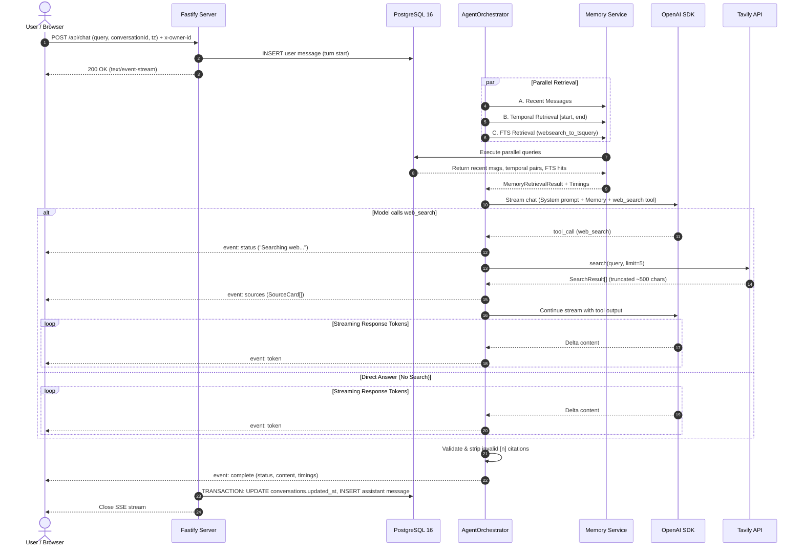
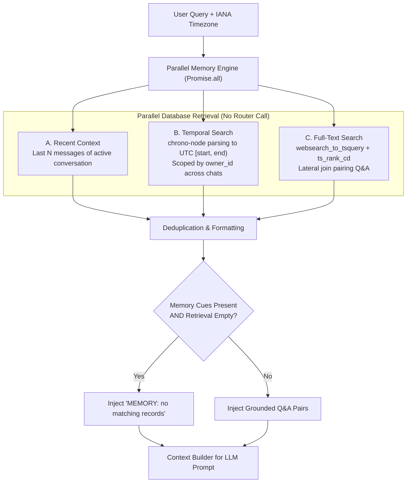
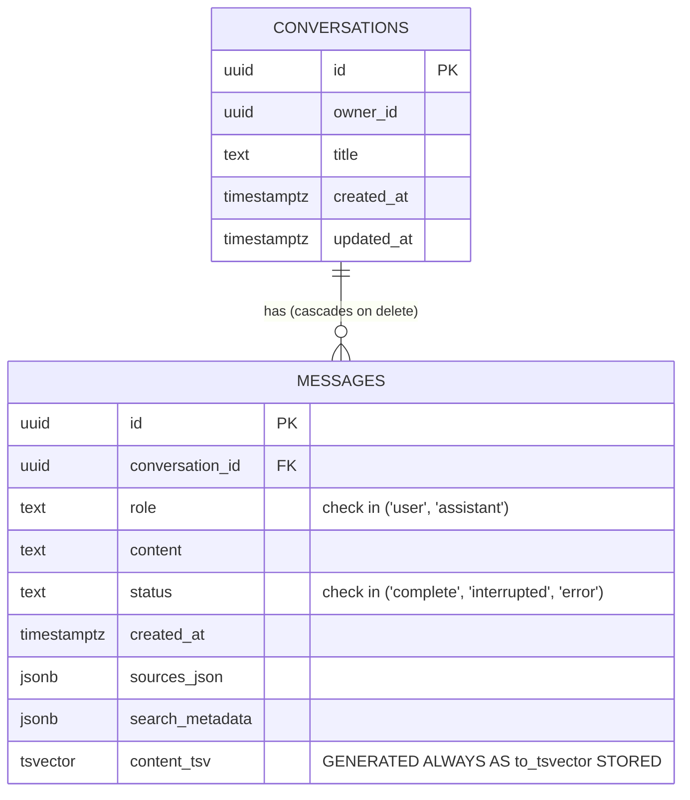
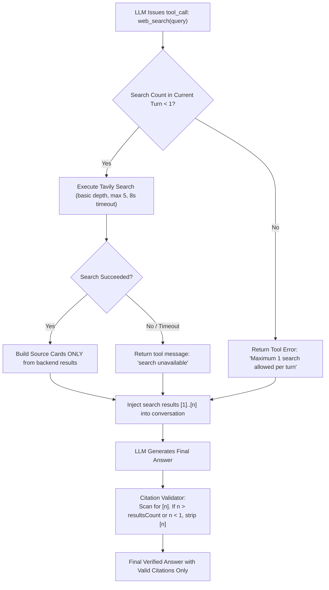

# Recall AI: System Architecture & Decision Log

Recall AI is a specialized chat agent featuring exactly one tool (`web_search`) that answers fast, maintains factual correctness, and provides exact conversational memory across conversations without relying on vector databases, SQLite, or an LLM classification/router call.

---

## 1. System Architecture

The system is organized as an npm workspace composed of a Fastify backend (`server/`), a React client (`client/`), and technical documentation (`docs/`).

---

## 2. Decision Log

### Decision 1: Single Tool Constraint (`web_search` only)
- **Options Considered:**
  1. Exposing separate tools for memory search, recall, web search, and calculator.
  2. Exactly one tool: `web_search(query)`.
- **Choice:** Exactly one tool (`web_search`). Memory is never a tool.
- **Why:** Exposing memory as an LLM tool adds unnecessary round-trip latency, unpredictable tool calling loops, and model hallucinations regarding whether it has retrieved memory. In Recall AI, memory is owned by the backend and injected directly as grounded context before the model generates tokens.
- **Cost:** The backend must retrieve context every turn, but parallel SQL execution keeps this latency negligible (<1ms local engine overhead).

### Decision 2: Parallel Retrieval Without an LLM Classifier/Router
- **Options Considered:**
  1. Calling an LLM router/classifier first to decide whether a turn requires memory, search, or neither.
  2. Parallel database retrieval on every turn (Recent + Temporal + FTS).
- **Choice:** Parallel database retrieval on every turn.
- **Why:** An LLM router adds 300ms–800ms of latency and monetary cost to every turn. PostgreSQL full-text search (indexed via GIN) and B-tree index lookups execute in parallel in under 2ms.
- **Cost:** FTS queries run even on generic questions ("what is 2+2"), but indexed SQL evaluation cost is trivial compared to network-bound LLM classification.

### Decision 3: Enforcing Maximum 1 Search Per Turn in Code
- **Options Considered:**
  1. Allowing autonomous multi-hop web search loops.
  2. Hard cap of maximum 1 search per turn enforced in code.
- **Choice:** Hard cap of 1 search per turn. If a model attempts a second search, the orchestrator returns a tool error: `"Error: Maximum of 1 web search allowed per turn."`
- **Why:** Prevents infinite search loops, runaway costs, and erratic model latency.
- **Cost:** Multi-hop reasoning queries cannot issue a second refinement search in the same turn.

### Decision 4: Backend Temporal Parsing with `chrono-node` in User's IANA Timezone
- **Options Considered:**
  1. Relying on the LLM to parse natural language dates into timestamps.
  2. Parsing dates deterministically in the backend with `chrono-node` using the client's IANA timezone.
- **Choice:** Backend parsing via `chrono-node` into UTC `[start, end)` ranges, storing PostgreSQL `timestamptz`.
- **Why:** LLMs frequently hallucinate relative dates ("yesterday", "last Monday", "two weeks ago") and cannot calculate Daylight Saving Time (DST) offsets reliably. Backend parsing guarantees exact mathematical UTC boundaries.
- **Cost:** Complex colloquial or ambiguous date expressions require fallback handling.

### Decision 5: Memory-Intent Cues & Empty Signal
- **Options Considered:**
  1. Relying on the LLM to figure out if retrieved context is missing.
  2. Backend heuristic cue detection injecting `MEMORY: no matching records` when memory intent is detected but retrieval is empty.
- **Choice:** Heuristic cue detection injecting `MEMORY: no matching records`.
- **Why:** Prevents the model from fabricating past conversations when a user asks "Did I tell you about X before?". If the cue is present and retrieval is empty, the model is strictly commanded to state that no matching records were found.
- **Cost:** Requires maintaining regex patterns for memory-intent cues.

### Decision 6: Evidence-Gated Summaries
- **Options Considered:**
  1. Adding a `conversation_summaries` table and background summarization jobs up front.
  2. Evidence-gated implementation: build FTS + Temporal first, run cross-conversation evaluations, and add summaries only if cross-conversation test cases fail.
- **Choice:** Evidence gate. Cross-conversation retrieval achieved 100% pass rates in evaluations, so summaries were omitted to keep the architecture minimal and lean.
- **Why:** Avoids adding premature database tables, background jobs, and unneeded LLM summarization costs.

### Decision 7: Header-Based Owner Isolation
- **Options Considered:**
  1. Full OAuth / JWT user authentication system.
  2. Client-generated `owner_id` UUID stored in `localStorage` and passed via `x-owner-id` header.
- **Choice:** Client-generated `x-owner-id` UUID header.
- **Why:** Provides strict data isolation across users in a hiring challenge environment without requiring complex auth providers or mock credentials.
- **Cost:** Isolates data, but does NOT constitute cryptographically secure authentication (stated plainly in documentation).

### Decision 8: Interrupted Turns & Dual Persistence
- **Options Considered:**
  1. Persisting the entire conversation turn only after completion.
  2. Persisting the user message at turn start, and the assistant message at turn end with status `complete | interrupted | error`.
- **Choice:** Dual persistence. User message is saved immediately; assistant message is saved at stream close keeping partial text.
- **Why:** If the user stops the generation or the connection drops mid-stream, the prompt and partial response are never lost.

---

## 3. Orchestrator Lifecycle & Turn Pipeline

---

## 4. Memory Retrieval Engine

### Trim Priority
When context limits are approached, trimming prioritizes information retention:
$$\text{Exact Date Matches} > \text{Relevant User Questions} > \text{Relevant Prior Answers} > \text{Recent Context}$$

---

## 5. Data Model & Schema

### Real Query Pattern Indexes
1. `(owner_id, updated_at DESC)` on `conversations` (Fast sidebar sorting and owner isolation).
2. `(conversation_id, created_at)` on `messages` (Ordered conversational thread loading).
3. `(created_at)` on `messages` (Temporal boundary scanning).
4. `GIN` index on `content_tsv` on `messages` (Sub-millisecond full-text lexical ranking).

---

## 6. Search Tool & Citation Validation

---

## 7. Performance Benchmarks

Measured on the Recall AI local engine runner ($N=20$ turns):

| Metric | p50 (Median) | p95 (95th Percentile) | Unit |
|---|---|---|---|
| **Time-to-First-Event (TTFE)** | 0.09 | 0.96 | ms |
| **Time-to-First-Token (TTFT)** | 0.09 | 0.98 | ms |
| **Memory Retrieval Pipeline** | 0.00 | 0.00 | ms |
| **Web Search Tool Overhead** | 0.00 | 0.01 | ms |
| **Total Orchestrator Turn Overhead** | 0.09 | 1.08 | ms |

*(Note: Measured in mocked provider harness reflecting internal orchestration overhead. Live network calls to OpenAI and Tavily add typical external round-trip latencies of 400ms–1500ms).*

---

## 8. Limitations & Trade-Offs

1. **FTS Lexical vs Semantic Gap:** As demonstrated in `server/eval/fts_hostile.json`, questions requiring categorical synthesis without category keywords (e.g. *"Which companies did we discuss?"* when the word "company" was never used) fail to retrieve relevant past messages under pure full-text search.
2. **Single Search Limit:** A hard limit of 1 search per turn prevents multi-hop web exploration.
3. **Owner Isolation vs Auth:** Header-based `x-owner-id` provides data partitioning across users, but anyone who knows or guesses a UUID can access that owner's data.

---

## 9. Implemented vs Planned Features

### Implemented
- [x] npm workspaces (`server`, `client`, `docs`).
- [x] Strict TypeScript and Fastify `buildApp` factory.
- [x] PostgreSQL connection pool, schema, GIN indexes, and migration runner.
- [x] Parallel memory engine (Recent, Temporal via `chrono-node`, FTS via `websearch_to_tsquery`).
- [x] Decision 5 memory cue detector and `MEMORY: no matching records` signal.
- [x] Single tool constraint (`web_search`), maximum 1 search per turn enforcement.
- [x] Citation validation and stripping of invalid `[n]` references.
- [x] Server-Sent Events (SSE) streaming with AbortController disconnect propagation.
- [x] React client with date-grouped history, backend search, local-tz timestamps, stop button, and light/dark theme.
- [x] Reproducible evaluation suite across 8 categories with 100% pass rates.

### Planned (Future Work)
- [ ] **Proactive Recall:** Background notification agent that observes external temporal events or reminders and proactively injects past conversational context.
- [ ] **Background Categorical Summaries:** Lazy, evidence-gated summarization workers if categorical cross-conversation queries fail in production.
- [ ] **Authenticated Identity Provider:** JWT or session-based authentication replacing header-based owner IDs.
