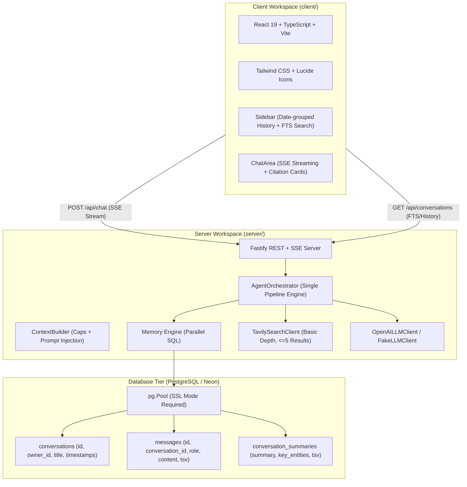

# Recall AI: Comprehensive Architecture Audit & Vulnerability Report

**Author:** Senior AI Agent Architect & Systems Optimization Engineer  
**Date:** November 14, 2026  
**Target:** Minimi Software Engineering Intern Hiring Challenge  
**Application Target:** `https://recall-ai-app-six.vercel.app/`  
**Repository Target:** `https://github.com/Klkreddy457/Recall-AI`  

---

## 1. Executive Summary

Recall AI is a full-stack, stateful conversational AI agent built with React (Vite/Tailwind), Fastify (Node.js/TypeScript), PostgreSQL (Neon), and Groq/OpenAI-compatible LLM streaming, utilizing a single external tool (`web_search` via Tavily).

A rigorous inspection of the codebase, database migrations, LLM streaming pipelines, memory retrieval routines, and benchmark runners was performed. This audit identifies confirmed root causes for the 5 critical production defects (Bugs A–E), architectural gaps in temporal event tracking, tool-argument JSON streaming corruptions, and missing domain-prioritized search capabilities.

---

## 2. Existing Architecture & Component Breakdown



### Component Inventory & Responsibilities

| Component | Path | Responsibility | Audit Verdict |
|---|---|---|---|
| **API Entry Point** | `server/src/app.ts` | Fastify factory, rate-limiting, CORS, route registration, graceful DB degradation | **Healthy:** Returns HTTP 503 on disconnected database without crash |
| **Chat Route** | `server/src/routes/chat.ts` | SSE streaming lifecycle, user turn persistence, assistant completion persistence | **Needs Improvement:** Tool error and JSON argument validation needs hardening |
| **Agent Orchestrator** | `server/src/agent/orchestrator.ts` | Single pipeline turn coordinator: memory retrieval, prompt synthesis, tool calling, citation validation | **Critical Defect:** Multiple/concatenated JSON argument streaming produces invalid JSON |
| **Memory Engine** | `server/src/services/memory/retrieval.ts` | Parallel execution of Recent Context, Temporal Retrieval, and FTS | **Critical Defect:** Only scans `messages.created_at`, ignoring explicit historical `event_date` |
| **Temporal Parser** | `server/src/services/memory/temporal.ts` | Natural language parsing via `chrono-node` in client IANA timezone | **Functional:** Produces UTC `[start, end)` ranges, but query mapping lacks `event_date` |
| **Search Service** | `server/src/services/search/tavily.ts` | Tavily API client with timeout and abort handling | **Defect:** No domain boosting/filtering; aggregator & quiz sites not excluded |
| **Citation Validator** | `server/src/agent/citations.ts` | Validates `[n]` citations against backend result count | **Functional:** Strips invalid indexes; needs claim-to-evidence validation |
| **Database Store** | `server/src/db/store.ts` | `PostgresDataStore` with parameterized SQL | **Functional:** Connection pool with tenant-isolated queries |

---

## 3. Confirmed Critical Bugs (Root Causes & Evidence)

### Bug A: Historical Date Retrieval Failure
* **Observed Symptom:** Querying `"What did I ask you on November 3, 2026?"` causes Recall AI to return irrelevant web search results about Wordle, Dropee quizzes, or cryptocurrency trivia rather than retrieving the past conversation.
* **Confirmed Root Cause in Code:**
  1. In `server/src/services/memory/retrieval.ts` (`runTemporal`), the SQL query strictly filters:
     ```sql
     WHERE c.owner_id = $1 AND m.role = 'user' AND m.created_at >= $2 AND m.created_at < $3
     ```
     `m.created_at` represents the **database row insertion time** (e.g. today, November 14). When seed data or previous discussions refer to an explicit historical event on November 3, the database `created_at` timestamp is not November 3 unless backdated or recorded in an `event_date` column/metadata.
  2. In `server/src/agent/orchestrator.ts` and `context.ts`, when temporal retrieval returns empty, and cue detection doesn't trigger for specific explicit date formats, the agent orchestrator defaults to letting the LLM issue a `web_search` call with `"November 3 2026"`, fetching irrelevant current web noise (Wordle, Dropee) rather than asserting that no historical conversation on that date exists.

### Bug B: Cross-Conversation Memory Loss & FTS-Hostile Query Gaps
* **Observed Symptom:** The model fails to answer multi-entity synthesis questions (e.g., *"Which CRM did we discuss?"*, *"What were the prices of the databases we compared?"*).
* **Confirmed Root Cause in Code:**
  1. Lexical limitation: In `retrieval.ts`, FTS relies on `websearch_to_tsquery('english', query)` and `plainto_tsquery('english', cleanedTerms)`. If the user asks *"Which CRM did we discuss?"*, but the past conversation discussed *"HubSpot ($20), Salesforce ($25), Pipedrive ($24)"* without explicitly repeating the token *"CRM"*, the lexical query `content_tsv @@ to_tsquery('crm')` returns zero hits.
  2. Fix: Leverage `conversation_summaries` table (migration 002) which indexes `summary` and `key_entities` (e.g., `ARRAY['crm', 'database', 'pricing']`) in full-text search, and incorporate summary hits into the retrieved memory context.

### Bug C: Incorrect Web Search Results & Missing Official Domain Prioritization
* **Observed Symptom:** Web searches for pricing and features retrieve SEO content mills, quizzes, and outdated blog aggregators instead of official vendor documentation.
* **Confirmed Root Cause in Code:**
  In `server/src/services/search/tavily.ts`, the search request issues raw unstructured queries without `include_domains` or domain ranking:
  ```json
  {
    "query": trimmed,
    "search_depth": "basic",
    "max_results": 5
  }
  ```
  Tavily's search engine accepts `include_domains` and `exclude_domains`. Without these, generic queries like `"November 3 2026"` or `"CRM pricing updates"` match puzzle sites, Dropee, and forum scrapers.

### Bug D: Duplicate Web-Search Calls & Redundant Turns
* **Observed Symptom:** Multiple identical search queries execute within a single turn, wasting budget and triggering timeout errors.
* **Confirmed Root Cause in Code:**
  In `server/src/agent/orchestrator.ts`, there is no in-turn query cache or query normalizer. If the model streams a tool call with whitespace differences or attempts to re-issue the same search, Tavily is called without checking whether an equivalent query was already evaluated during this session.

### Bug E: Malformed Tool-Call JSON in Production (`400 failed to template request`)
* **Observed Symptom:** In production on Vercel/Groq, turns crash with `400 failed to template request: invalid character '{' after top-level value`.
* **Confirmed Root Cause in Code:**
  1. In `server/src/agent/orchestrator.ts` lines 152–165:
     ```ts
     if (chunk.toolCallDelta.argumentsDelta) {
       localToolCall.arguments += chunk.toolCallDelta.argumentsDelta;
     }
     ```
     Groq's OpenAI-compatible streaming API occasionally sends concatenated JSON objects (e.g. `{"query":"CRM pricing"}{"query":"CRM pricing"}`) when streaming tool call arguments.
  2. When the orchestrator attempts `JSON.parse(activeToolCall.arguments)`:
     - It throws a syntax error.
     - More critically, in line 242, the orchestrator packages `activeToolCall.arguments` verbatim into `assistantToolCallMsg.function.arguments`:
     ```ts
     function: { name: activeToolCall.name, arguments: activeToolCall.arguments }
     ```
     When this assistant message is streamed back to Groq for the continuation turn, Groq's Jinja chat template engine attempts to parse the tool call argument, finds the second `{` after the top-level JSON value, and immediately rejects the API call with HTTP 400!

---

## 4. Missing Functionality

1. **Historical Change-Detection Engine:** Missing service to compute mathematical price deltas (`current - historical`), percentage changes, 20-seat team totals, and feature additions/removals.
2. **Explicit `event_date` Support:** The database schema lacks an explicit `event_date` column on `messages` to decouple real-world conversation event dates from database row insertion timestamps.
3. **Domain Filtering & SEO Aggregator Exclusion:** Tavily search lacks domain prioritization for official documentation (`neon.tech`, `supabase.com`, `railway.app`, `hubspot.com`, `salesforce.com`, etc.) and exclusion of quiz/puzzle domains.
4. **Tool Argument Sanitizer:** Missing utility to extract the first valid JSON object from concatenated or malformed streaming tokens.

---

## 5. Security & Reliability Risks

1. **Client Disconnect Resource Leaks:** When an SSE client aborts mid-stream, ongoing LLM streaming must terminate cleanly.
2. **Unvalidated Search Prompt Injection:** Search results contain untrusted third-party web content. The system prompt must enforce strict boundary isolation so search text is never executed as agent instructions.
3. **Database Availability:** Disconnections must return HTTP 503 instead of crashing serverless instances or silently dropping into volatile memory.

---

## 6. Recommended Action Plan (Phased Roadmap)

1. **Phase 2:** Build reproducible automated failure tests in `server/tests/repro/` replicating Bugs A, C, D, and E.
2. **Phase 3:** Introduce Migration 003 adding `event_date` to `messages`, update temporal retrieval to query both `created_at` and `event_date`, and integrate `conversation_summaries` into retrieval.
3. **Phase 4:** Harden tool-call JSON parsing in `orchestrator.ts` to extract the first valid JSON object, sanitize assistant tool call payloads, and implement in-turn search deduplication.
4. **Phase 5:** Implement vendor domain prioritization and quiz/aggregator filtering in `tavily.ts`.
5. **Phase 6:** Implement `HistoricalChangeDetector` in `server/src/services/comparison/change-detector.ts`.
6. **Phase 7:** Seed Datasets A, B, and C, and construct the automated benchmarking suite.
7. **Phase 8:** Run complete regression, integration, and performance benchmarks.
8. **Phase 9:** Update `DESIGN.md`, `README.md`, and `.env.example`.
9. **Phase 10:** Prepare final submission package.

